<div align="center">

### 📉 지금은 괜찮은 50~69세 중, **2년 뒤 빈곤선 아래로 반복해서 떨어질 사람**을 미리 찾는 머신러닝


<br/><br/>


<br/><br/>

📄 [최종 보고서](reports/final_report.docx) · 📊 [발표 자료](reports/presentation.pdf) · 🧭 [모델 설계도](reports/figures/model_blueprint.png) · 🔮 [서비스 데모: 미리사주](#-서비스-미리사주)

</div>

<br/>

## 🎯 문제 정의

> *"노후 계산기가 '괜찮다'고 한 사람, 정말 괜찮았을까?"*

기존 노후 진단은 **지금 소득 + 앞으로 받을 연금 ≥ 필요한 생활비**인지 공식으로 계산해요.
국민노후보장패널로 같은 계산을 재현해 보니 **'괜찮음' 판정 1,887명 중 10.4%** 가 이후 최소생활비 아래로 반복해서 내려갔고, 이렇게 떨어진 사람의 **약 95%는 기초생활보장 수급 기록이 없었어요.**

공식은 **지금의 숫자**만 보고, 소득이 출렁이는지 · 일이 끊기는지 · 연금 개시 전 공백이 있는지 같은 **흐름**은 못 봐요. 이 빈틈을 머신러닝으로 채우는 게 목표예요.

| | 정의 |
|---|---|
| **문제 형태** | 이진 분류 (사람 × 조사 차수 단위) |
| **대상** | 50~69세 + 지금 균등화 소득이 빈곤선 **이상** (계산상 "괜찮은" 사람) |
| **정답 y = 1** | t+2 · t+3 · t+4 관측 중 **2번 이상** 빈곤선 아래 (한 번 잠깐 내려간 건 제외) |
| **빈곤선** | 복지패널 전 연령 균등화 가처분소득 가중 중위값의 **50%** (OECD 상대빈곤) |
| **기준 모델** | B0 지금 소득 하나 · B1 소득·나이·취업 로지스틱(계산기형) |

<br/>

## 🗂️ 데이터

같은 사람을 매년(또는 격년) 추적하는 **국가 패널 6개**를 공통 스키마로 묶었어요. 학습 **103,864행** · 시험 **31,544행**.

| 역할 | 패널 | 소득 기준 | 쓰임 |
|:-:|---|:-:|---|
| ⚖️ 판정 | 한국복지패널 · 재정패널 · 국민노후보장패널 | 가처분 | 모델 성능 판정 (메타분석) |
| 🔁 재현 · 이식 | 한국노동패널 · 한국의료패널 · 고령화연구패널 | 경상 | 다른 패널에서도 통하는지 확인 |

- **시간순 분할**: 과거 연도로 학습하고 최근 연도(예: 복지패널 2020 · 2021)로 시험해요. 같은 사람이 미래 정보를 미리 보지 않게 했어요.
- **같은 열 · 같은 가격 · 같은 정답**: 6개 패널의 변수 이름(공통 입력 17개), 물가(CPI 2023년 가격), 기준선, 라벨 정의를 맞췄어요.

> 🔒 **원자료는 저장소에 없어요.** 각 패널 이용약관상 재배포가 금지돼 있어서 개인 단위 값은 빼고 **집계 수치만** `results/`에 남겼어요. → [`data/README.md`](data/README.md)

<br/>

## 🛠️ Feature Engineering

전체 모델 43개, 서비스 모델은 사람이 직접 답할 수 있는 **21문항 → 30개 변수**로 만들었어요.

| 묶음 | 변수 예시 | 아이디어 |
|---|---|---|
| 💰 **소득 수준** | `log_dratio` = ln(균등화 가처분소득 ÷ 빈곤선) | 기준선에서 얼마나 떨어져 있나 |
| 📉 **소득 흐름** | `d_log_ratio_1y/2y`, `min_ratio_hist`, `vol_hist` | 최근 변화량 · 3년 중 최저 · 변동성 |
| 👴 **나이 · 연금 공백** | `age_to_60`, `age_to_nps` (국민연금 개시까지 남은 해) | 연금이 열리기 전 소득 공백 |
| 💼 **일** | `employed`, `lost_job_2y`, 상용 · 임시일용 · 자영업 | 일이 끊길 위험 |
| 👨‍👩‍👧 **가구** | `hhsize`, `hh_change_2y` | 가구원 수와 그 변화 |
| 🏠 **재산 · 부채** | 금융자산 · 부채 · 부동산 ÷ 연소득, sign·log 변환 | 소득이 줄어도 버틸 완충 |

전체 정의와 결측률은 [`docs/variable_spec.md`](docs/variable_spec.md)에 있어요.

<br/>

## 🧠 모델링

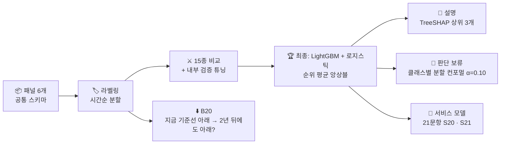

- **15종 비교**: 로지스틱(L1·L2) · GAM · LDA · GaussianNB · KNN · DecisionTree · RandomForest · ExtraTrees · AdaBoost · GradientBoosting · HistGB · XGBoost · LightGBM · CatBoost
- **최종 모델**: LightGBM과 로지스틱의 점수를 시험 기간 분위수로 바꿔 평균 (서로 다른 실수를 보완)
- **사전 등록**: 실험 **전에** 통과 기준을 [`validation/preregistration/`](validation/preregistration)에 적고 그대로 판정했어요.

<table>
<tr>
<td width="55%">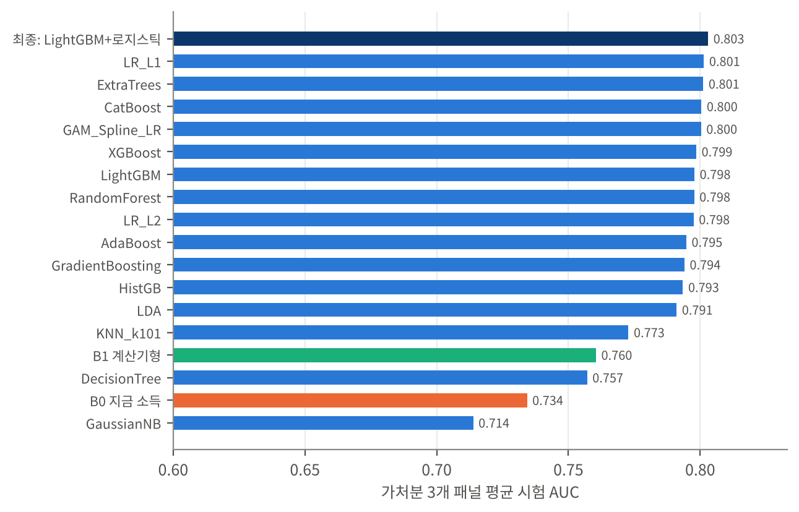</td>
<td width="45%">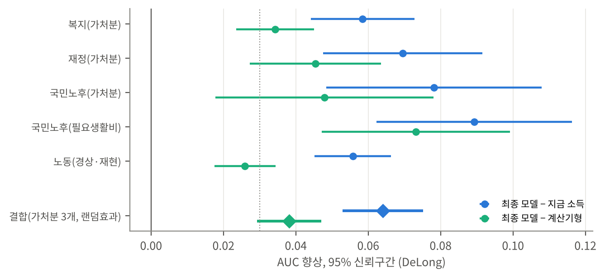</td>
</tr>
<tr>
<td align="center"><sub>15종 비교 (가처분 3개 패널 평균 시험 AUC)</sub></td>
<td align="center"><sub>지금 소득 대비 AUC 향상, 95% 신뢰구간 (DeLong)</sub></td>
</tr>
</table>

<br/>

## 📈 결과

| 지표 | 값 | 비고 |
|---|:-:|---|
| 🎯 **복지패널 시험 AUC** | **0.811 → 0.870** | 지금 소득만 → 최종 모델 (4,984행) |
| 📊 **판정 3개 패널 결합 향상** | **+0.064** [+0.053, +0.075] | 랜덤효과 메타분석, 3개 패널 모두 양수 |
| 🔍 **상위 20%에서 찾은 실제 하락자** | **192 → 226명 (+18%)** | 같은 인원(996명)을 살폈을 때 |
| 📝 **21문항 서비스 모델 S20** | **0.868** | 전체 입력 모델과 차이 0.001, 사전 기준 통과 |
| ⬇️ **기준선 아래 모델 B20** | **0.813** vs 0.690 | 사전 기준 3개 모두 통과 |
| 🎚️ **Brier score** | 0.0496 vs 0.0567 | 기준(전체 평균 확률) 대비 |

<table>
<tr>
<td width="50%">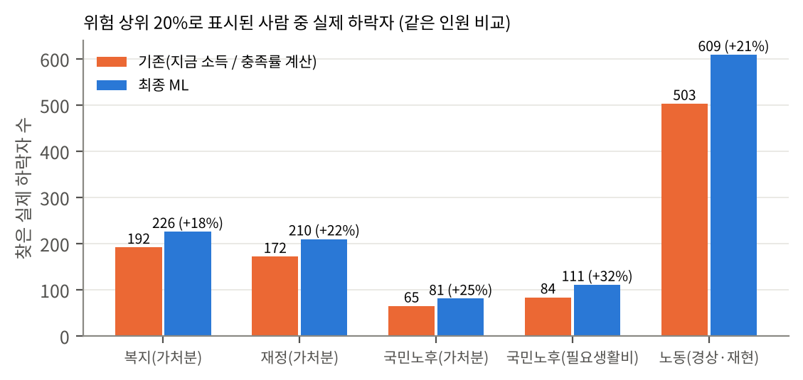</td>
<td width="50%">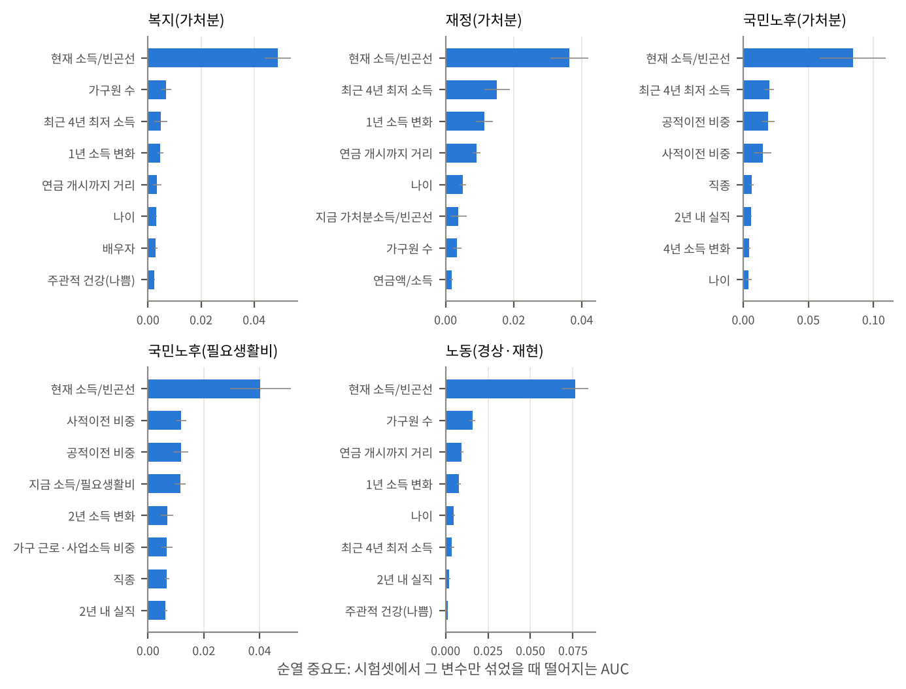</td>
</tr>
<tr>
<td align="center"><sub>같은 인원을 살폈을 때 찾은 하락자 수 (+18~32%)</sub></td>
<td align="center"><sub>순열 중요도: 지금 소득 다음으로 흐름 · 연금 · 가구 변수</sub></td>
</tr>
</table>

<br/>

## 🧪 외운 게 아니라 배웠나? (강건성 검증)

| 검증 | 결과 |
|---|---|
| 🔀 **라벨 셔플** | 정답을 섞으면 AUC 0.45~0.51 → 우연 수준으로 떨어짐 |
| 📚 **학습곡선** | 데이터가 늘수록 시험 AUC 상승, 부스팅 반복이 늘어도 시험 성능은 평탄 |
| 🔁 **재현 · 이식** | 복지패널 모델을 다른 5개 패널에 그대로 적용해도 지금 소득보다 나음 |
| 👥 **하위 집단** | 성별 · 학력 · 나이 · 취업 · 가구 형태 모든 집단에서 향상이 양수 |
| 🎚️ **보정** | 원 확률과 재보정 후 확률 모두 관측 하락률과 비교 (ECE · Brier) |
| 🔊 **회상 소득 잡음** | 1·2년 전 소득에 ±20% 잡음 → AUC −0.0009, ±40% → −0.0037 |
| ✅ **설계도 검정** | 보고서 설계도와 실제 코드가 맞는지 자동 검정 (전체 26개 · 모델별 91개) |

<table>
<tr>
<td width="50%">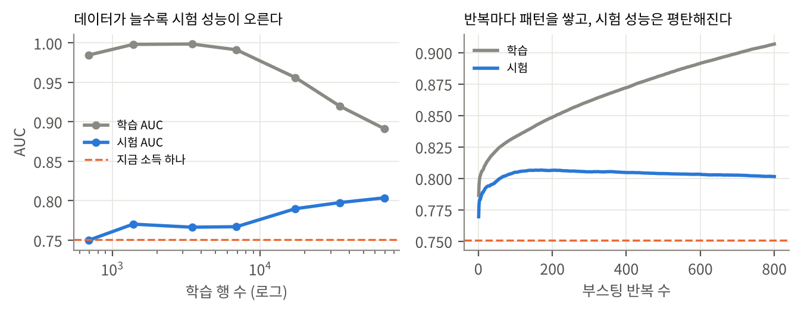</td>
<td width="50%">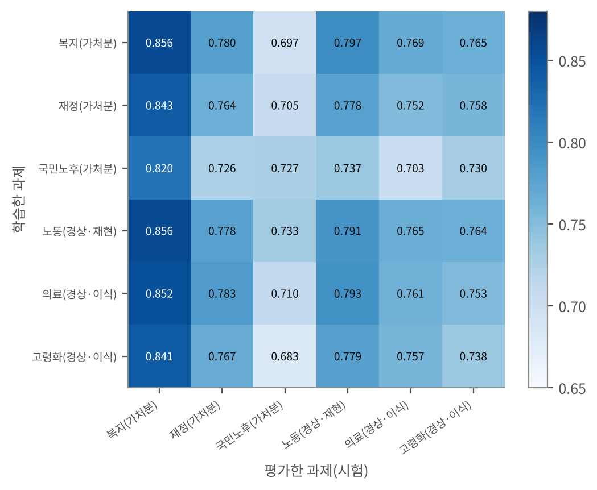</td>
</tr>
<tr>
<td align="center"><sub>학습곡선 · 부스팅 반복에 따른 학습/시험 AUC</sub></td>
<td align="center"><sub>학습 패널(행) → 시험 패널(열) 이식 AUC</sub></td>
</tr>
</table>

<br/>

## 🔮 서비스: 미리사주

모델을 **사주 콘셉트의 웹 서비스**로 만들었어요. 21문항에 답하거나 상담 챗봇과 대화하면 2년 뒤 풀이 · 이유 3가지 · 판단 보류를 보여주고, **공공기관 공식 사이트**(복지로 · 고용24 · 국민연금공단 등)로 이어줘요.

<table>
<tr>
<td width="50%"></td>
<td width="50%">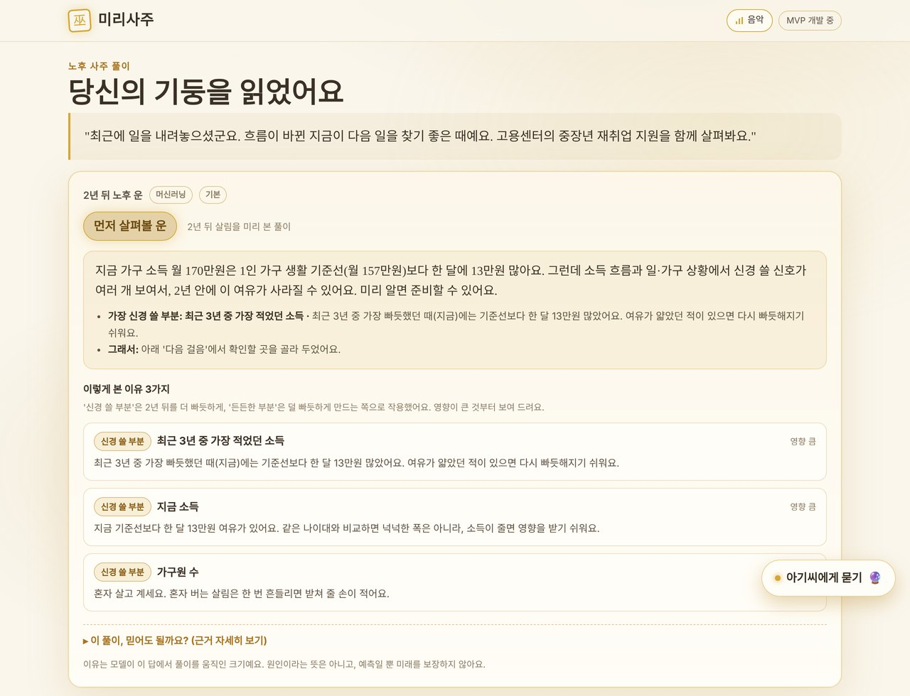</td>
</tr>
<tr>
<td align="center"><sub>시작 화면</sub></td>
<td align="center"><sub>결과: 위험 구간 · 이유 3가지(TreeSHAP) · 같은 자리 100명 중 하락 비율</sub></td>
</tr>
<tr>
<td>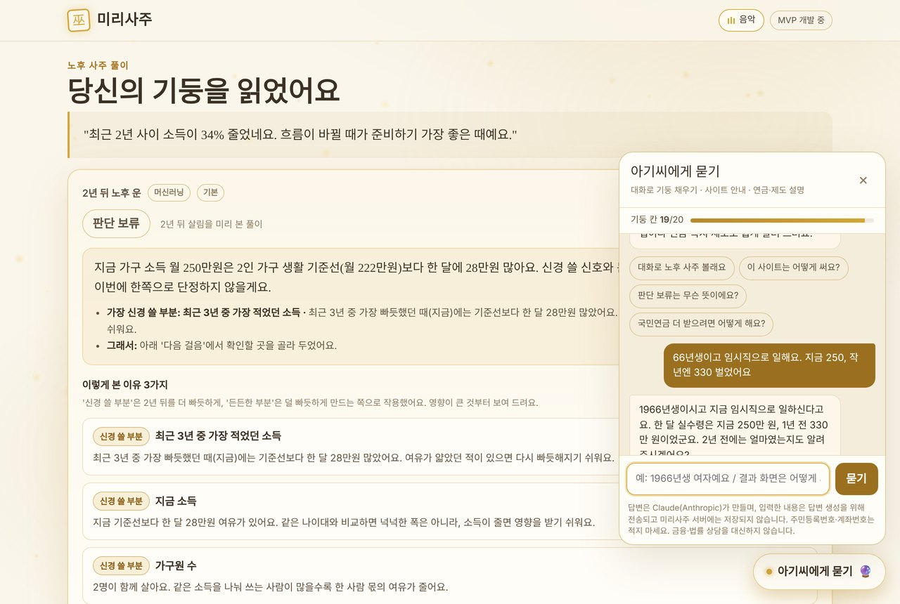</td>
<td>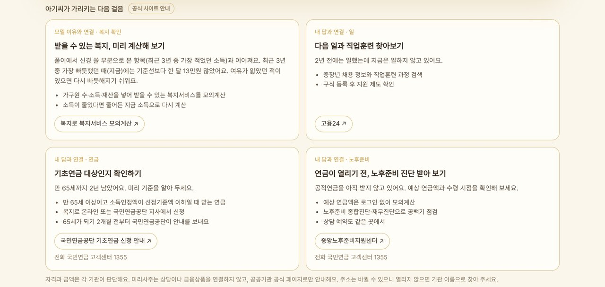</td>
</tr>
<tr>
<td align="center"><sub>상담 챗봇: 대화에서 입력값을 뽑아 채움 (Claude API)</sub></td>
<td align="center"><sub>다음 걸음: 공식 사이트만 안내</sub></td>
</tr>
</table>

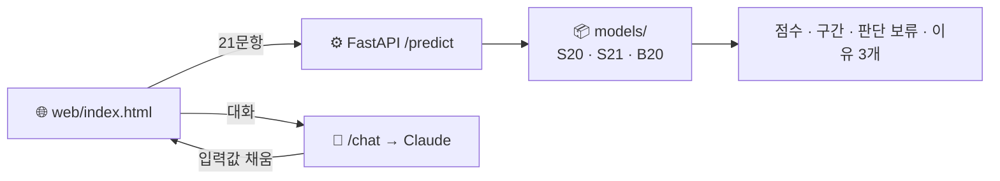

> 🔒 **입력은 저장하지 않아요.** 서버는 요청 본문을 로그에 남기지 않고, 챗봇 대화는 브라우저 메모리에만 있어요.

<br/>

## 📁 저장소 구조

```
retirement-income-cliff-ml/
├── data/                       # 📦 원자료 받는 법 (원자료는 올리지 않음)
├── src/                        # 🧪 학습 파이프라인
│   ├── 00_eda/                 #   탐색적 분석
│   ├── 01_panel_conversion/    #   패널 6개 → 공통 스키마
│   ├── 02_labeling_split/      #   물가 · 가구원 보정, 빈곤선, 라벨, 시간순 분할
│   ├── 03_model_experiments/   #   15종 비교 · 앙상블 · DeLong · 메타분석 · 이식 · B20
│   ├── 04_service_model/       #   21문항 서비스 모델, 배포 패키지 생성
│   ├── 05_report_figures/      #   보고서 그림 · 문서 생성
│   └── 99_archive/             #   이전 실험 (기록용)
├── models/                     # 🏆 학습된 모델 + predict.py + 일치 시험(합성 300건)
├── results/                    # 📊 집계 수치 (csv · json)
├── validation/                 # ✅ 사전 등록 기준 · 설계도 검정
├── logs/                       # 🧾 학습 · 실험 실행 기록
├── reports/                    # 📚 최종 보고서 · 발표 자료 · 그림(g01~g14, EDA)
├── app/
│   ├── backend/                # ⚙️ FastAPI (/predict · /chat · /health), 테스트 23개, Dockerfile
│   └── web/                    # 🌐 미리사주 프론트엔드
├── experiments/web_output/     # 🧩 화면 개선 실험 (버전별 html, 패치, 종단 테스트)
└── docs/                       # 📝 변수 명세 · 입력값 리스트 · README 이미지
```

<br/>

## 🚀 실행 방법

**모델만 써보기**
```bash
cd models
pip install -r requirements.txt
python test_parity.py      # 합성 300건 일치 시험
```
```python
from predict import Model
m = Model('model')
m.predict(dict(birth_year=1964, female=0, married=1, edu3=1, hh_size=2, hh_size_2y=3,
               pension_recv=0, retire_pension=1, private_pension=0,
               income_now=280, income_1y=330, income_2y=400,
               employed=0, employed_1y=1, employed_2y=1, job_type='none',
               owner=1, fin_asset=3000, real_asset=35000, debt=4000))
```

**API 서버**
```bash
cd app/backend
pip install -r requirements-dev.txt
python -m pytest -q tests
ENABLE_PREDICT=1 ALLOWED_ORIGINS=http://localhost:8765 uvicorn app.main:app --port 8000 --no-access-log
```

**학습 재현**: 승인받은 원자료를 둔 뒤 `src/01 → 02 → 03 → 04` 순서로 실행해요.

<br/>

## 👥 팀원 (TEAM 06 투바투)

| 이름 | 역할 |
|:-:|---|
| **허민영** (팀장) | 전체 리드 · 역할 분배, 데이터 총괄 · 모델링 |
| **강우영** | 도메인 리서치, 발표 자료, 모델링 · 타당성 검토 |
| **김성진** | 서비스 프론트엔드, 패널 간 데이터 통합, 시각화 · 모델링 |
| **조성원** | 데이터 수집, AI 상담 챗봇 백엔드, 시각화 · 모델링 |

<br/>

## ⚠️ 한계

- **판단 보류가 많아요** (서비스 모델 28%, B20 47%). 확신이 낮을 때 결론을 아끼도록 설계한 결과예요.
- AUC 0.85 이상은 복지패널(0.870)뿐이고, 재정패널 0.794 · 국민노후패널 0.746이에요.
- 국민연금공단의 실제 개인별 판정 기록이 없어 패널 응답으로 같은 계산을 재현했어요.
- 예측 모델이지 **원인 분석이 아니며**, 금융 · 법률 상담을 대신하지 않아요.
- 패널 자료로 학습한 모델이라, 공개 서비스로 운영하기 전에 각 패널 기관의 이용 조건을 확인해야 해요.


